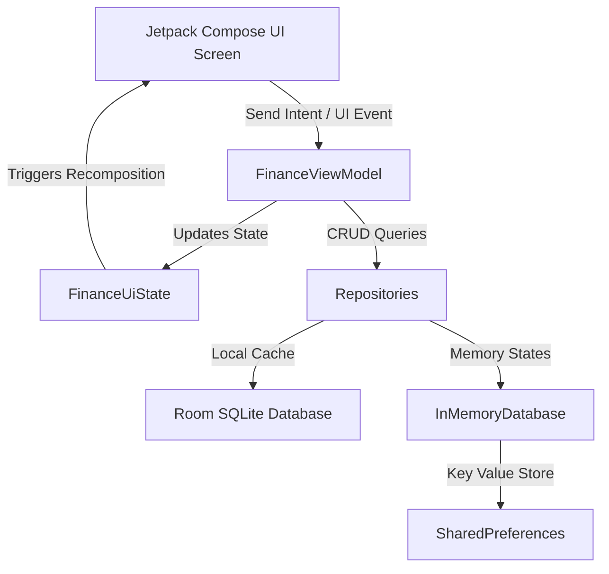

# VibeFinance 📊✨

VibeFinance is a modern, high-fidelity personal finance and daily budgeting Android application. Built using Jetpack Compose and Kotlin, it delivers a state-of-the-art visual experience with interactive animations, custom card layouts, and local data persistence. The design is highly inspired by the daily budgeting philosophy of **[Buckwheat](https://github.com/bndkt/buckwheat)** and the refined Material 3 UI/UX architecture of **[ImageToolbox](https://github.com/T8RIN/ImageToolbox)**.

---

## 🚀 Features

### Interactive Motion Orchestration for Compact/Detailed View Toggle in AssetsScreen (1.2.69)
- **2-Phase Icon Motion & Turnaround Glyph Swap (`AccountsScreen.kt`)**:
  - Detailed -> Compact: Phase 1 focuses with an emphasized burst scaling up to `1.25x` (`150ms`, `MotionTokens.EmphasizedDecelerate`), morphs the glyph from `ViewStream` to `ViewAgenda` at the momentum peak, and Phase 2 settles smoothly down to the compact resting scale `0.90x` (`16.dp` equivalent) via `Spring.DampingRatioMediumBouncy` and `Spring.StiffnessMediumLow`.
  - Compact -> Detailed: Phase 1 squashes down into an accelerated trough scaling down to `0.75x` (`150ms`, `MotionTokens.EmphasizedAccelerate`), morphs the glyph back to `ViewStream` at the momentum turnaround, and Phase 2 blooms smoothly back up to the standard resting scale `1.0x` (`18.dp`).
  - Zero-recomposition GPU layering: animated scaling runs strictly inside `Modifier.graphicsLayer` to prevent layout re-measuring or container stutter.
- **Directional Slide & Soft Fade Label Transition**:
  - Encapsulated button label text inside `AnimatedContent`:
    - Switching to compact: directional downward slide (`slideInVertically { -it / 2 }` + `fadeIn(150)`) paired with `slideOutVertically { it / 2 }` + `fadeOut(150)`.
    - Switching to detailed: directional upward slide (`slideInVertically { it / 2 }` + `fadeIn(150)`) paired with `slideOutVertically { -it / 2 }` + `fadeOut(150)`.
- **Accessibility & Reduced Motion (`MotionLevel.MINIMAL`)**:
  - Evaluates `LocalExperience.current.motion == MotionLevel.MINIMAL`. When reduced motion is preferred, icon scaling and glyph swaps snap instantly with `EnterTransition.None togetherWith ExitTransition.None`.
  - First-composition guard prevents accidental animations on initial screen entry.

### Material 3 Motion Tokens & MotionScheme Comprehensive Component Application (1.2.68)
- **Component Application of MotionTokens & MotionScheme**:
  - **SpendsCalendar.kt**: Applied `MotionTokens.standardEnter()` / `MotionTokens.emphasizedEnter()` and `MotionTokens.standardExit()` / `MotionTokens.emphasizedExit()` to the `ExpressiveDualViewSwitcher` checkmark transition, and `MaterialTheme.motionScheme.fastEffectsSpec<Float>()` to the dual view mode transition crossfade.
  - **HomeScreen.kt**: Applied `MotionTokens.standardEnter()` / `MotionTokens.emphasizedEnter()` and `MotionTokens.standardExit()` / `MotionTokens.emphasizedExit()` to the category filter reset button `AnimatedVisibility`.
  - **CategoryBreakdownCard.kt**: Applied `MotionTokens.emphasizedEnter()` / `MotionTokens.standardEnter()` and `MotionTokens.emphasizedExit()` / `MotionTokens.standardExit()` to the interactive category detail popover card `AnimatedVisibility`.
  - **RecurringScreen.kt**: Applied `MotionTokens` to category filter reset `AnimatedVisibility`, category breakdown center text transition `AnimatedContent`, and subscription/installment item removal `AnimatedVisibility`.
  - **MainScreen.kt**: Applied `MotionTokens.emphasizedEnter(220)` to `sheetDepthProgress`, `MotionTokens.emphasizedEnter(180)` / `MotionTokens.emphasizedExit(120)` to FAB `AnimatedContent`, `MotionTokens.emphasizedEnter(210)` / `MotionTokens.emphasizedExit(90)` to `tabChangeTopLevel` `AnimatedContent`, and `MotionTokens.emphasized(320)` to transaction mode switch indicator drawing progress.

### Global Expressive Button Style & Shape Morphing Suite (1.2.67)
- **Theme-Level Button Shape Style (`CompletePressButtons.kt`, `Theme.kt`)**:
  - Implemented `AppButtonDefaults` compliant with Material 3 Expressive guidelines:
    - Resting shape: `CircleShape` (stadium pill).
    - Pressed shape: `RoundedCornerShape(percent = 32)` (smooth rounded rectangle).
    - `AppButtonDefaults.shapes(shape, pressedShape)` builder utilizing `ButtonDefaults.shapes(...)`.
  - Exposed `LocalAppButtonShapes = staticCompositionLocalOf<ButtonShapes?> { null }`.
  - Integrated `LocalAppButtonShapes provides AppButtonDefaults.shapes()` into `CompositionLocalProvider` within `VibeFinanceTheme` in `Theme.kt`.
- **Public Expressive Button Suite (`AppButton`, `AppFilledTonalButton`, `AppOutlinedButton`, `AppTextButton`)**:
  - Encapsulated `@ExperimentalMaterial3ExpressiveApi` within internal button implementation, providing clean non-experimental public overloads for standard button callers.
  - Provided `@ExperimentalMaterial3ExpressiveApi` overloads for callers requiring custom `shapes: ButtonShapes`.
  - Upgraded `CompletePressButton`, `CompletePressFilledTonalButton`, `CompletePressOutlinedButton`, and `CompletePressTextButton` to default to `shapes: ButtonShapes = defaultButtonShapes()`.
- **Motion Reduction Compliance (`CompletePressShape.kt`)**:
  - Wired `LocalExperience.current.motion == MotionLevel.MINIMAL` support into `rememberCompletePressProgress`, automatically executing `snap()` when reduced motion is preferred.
- **Consumer Adoption**:
  - Migrated dialog action buttons in `HeroDailyBudgetCard.kt` and statement action buttons in `SpendsCalendar.kt` to `AppButton` and `AppTextButton`.

### Material 3 Motion Tokens & Root Expressive MotionScheme Integration (1.2.66)
- **Official Material 3 Easing Sets & Duration Tokens (`Motion.kt`)**:
  - Implemented centralized `MotionTokens` implementing the official Material 3 Motion specification:
    - **Emphasized Easing Set**: `Emphasized` (`CubicBezierEasing(0.2f, 0f, 0f, 1f)`), `EmphasizedDecelerate` (`CubicBezierEasing(0.05f, 0.7f, 0.1f, 1f)`), and `EmphasizedAccelerate` (`CubicBezierEasing(0.3f, 0f, 0.8f, 0.15f)`).
    - **Standard Easing Set**: `Standard` (`CubicBezierEasing(0.2f, 0f, 0f, 1f)`), `StandardDecelerate` (`CubicBezierEasing(0f, 0f, 0.2f, 1f)`), and `StandardAccelerate` (`CubicBezierEasing(0.3f, 0f, 1f, 1f)`).
    - **Expressive Overshoot Curve**: Standardized `FancyTransitionEasing = CubicBezierEasing(0.48f, 0.19f, 0.05f, 1.03f)`.
    - **Material 3 Duration Tokens**: `DurationShort1` (50ms) through `DurationExtraLong4` (1000ms).
    - **Convenience Animation Spec Builders**: `emphasized()`, `emphasizedEnter()`, `emphasizedExit()`, `standard()`, `standardEnter()`, `standardExit()`, and `fancy()` spec helpers.
- **Root-Level `MotionScheme` Injection (`Theme.kt`)**:
  - Wired `MotionScheme.expressive()` as the default motion scheme directly into `MaterialTheme(motionScheme = ...)` at the root theme level.
  - Automatically falls back to `MotionScheme.standard()` when `motion == MotionLevel.MINIMAL`, fully respecting reduced-motion accessibility settings.
  - Provided overloaded `VibeFinanceTheme` constructors to prevent caller pollution from `@ExperimentalMaterial3ExpressiveApi`.
- **Centralized Motion Token Adoption**:
  - Cleaned up ad-hoc curves across `SettingsDrawerHost.kt`, `AssetEditorMotion.kt`, and `HistorySearchControls.kt` to consume centralized `MotionTokens`.

### Guaranteed Full-Cycle Shape Changing on Quick Press & MotionLevel.MINIMAL Compliance (1.2.65)
- **Guaranteed Full-Cycle Shape Changing on Quick Taps (`BouncyClickable.kt`, `RestAndSpentBudgetCard.kt`, `CompletePressShape.kt`)**:
  - Upgraded `rememberExpressiveCardPress` and `RestAndSpentBudgetCard`'s `pressProgress` to use the coroutine-based `rememberCompletePressProgress` latch.
  - Even on brief taps (< 100ms), the animation guarantees completing the full inward contraction (`28.dp` -> `16.dp` at 160ms `FastOutSlowInEasing`) before springing back (`16.dp` -> `28.dp` under `Spring.DampingRatioMediumBouncy` and `Spring.StiffnessMediumLow`), ensuring the shape morph is never aborted or truncated mid-way.
  - Long presses continuously hold at `16.dp` for the full duration of touch, rebounding smoothly back to `28.dp` when released.
  - Upgraded `bouncyClickable` and `pressBounce` with the same full-cycle playback guarantee.
  - Added full `MotionLevel.MINIMAL` support: all press and release specs instantly `snap()`, fully honoring reduced motion preferences.

### Unified Corner DP Shape Morphing & Bounded Semantic Ripple Highlights across Daily Cards (1.2.64)
- **Unified Tactile Shape Morphing (`28.dp` -> `16.dp`) across All Daily Cards (`BouncyClickable.kt`, `HomeScreen.kt`, `HeroDailyBudgetCard.kt`, `WholeBudgetCard.kt`, `RestAndSpentBudgetCard.kt`, `DaysLeftCard.kt`, `MinMaxSpentCard.kt`, `DailySpendingLineChart.kt`, `SpendsCalendar.kt`, `StatCard.kt`)**:
  - Implemented `rememberExpressiveCardPress(restingCorner = 28.dp, pressedCorner = 16.dp)` and `Modifier.expressiveCardClickable(pressState, rippleColor)` to provide genuine Jetpack Compose dynamic corner morphing across every card on the Daily page.
  - Corner radius dynamically morphs from `28.dp` (resting) down to `16.dp` (pressed) under spring kinetics (`Spring.DampingRatioMediumBouncy`, `Spring.StiffnessMediumLow`) with playful overshoot recovery on release.
  - Card bounding edges remain strictly fixed (`left`, `top`, `right`, `bottom`), preventing edge displacement while fulfilling `boundsInRoot` invariants.
  - Applied Material You semantic bounded ripple highlights (`ripple(bounded = true, color = semanticColor)`): Primary for Hero, Whole Budget, Rest/Spent, Days Left, Category Donut, and Lowest Expense cards; Error for Highest Expense card; OnSurfaceVariant for Total Expenses, Spending Trend, and Financial Rhythm Heatmap cards.
- **Preserved Exact Specs**: Maintained 100% of the wavy circular progress indicator and badge styling in `DaysLeftCard.kt`, with zero fish overlay on Hero Daily Budget card.

### Hero Card Fish Removal, Preserved Wavy Style & Fixed-Edge Corner DP Shape Morphing (1.2.62)
- **Preserved Wavy Style & Spec (`DaysLeftCard.kt`)**: Kept `DaysLeftCard`'s original Material 3 wavy circular progress indicator and Bento card shape (`BentoCardShape`, `CircleShape` center badge) strictly unmodified according to original specifications.
- **Hero Card Fish Removal (`HeroDailyBudgetCard.kt`)**: Removed `TopDownFishPondOverlay` from `HeroDailyBudgetCard`, completely removing swimming fish, flop animations, and water ripples from the Hero Daily Budget card while preserving smooth 120 FPS liquid wave motion and responsive typography.
- **Fixed-Edge Corner DP Shape Morphing (`BouncyClickable.kt`)**: Set `inset = 0f` in `ExpressivePressedShape`. Card edges remain firmly anchored at their layout positions while only the corner radius (dp of corners) morphs smoothly under spring physics (`cornerScale = 1f - 0.50f * amount`), ensuring pure Material 3 Expressive corner shape morphing without shifting edges.

### Dynamic Shape Morphing across Daily Cards (1.2.61)
- **Asymmetric Bento & Pill Morphing (`DaysLeftCard.kt`, `RestAndSpentBudgetCard.kt`)**: Added organic Material 3 Expressive shape morphing across Daily cards:
  - `DaysLeftCard`: Central badge smoothly morphs between a 14dp pill in Flat mode and a 5dp squircle with subtle spring bounce scaling (`1.05f`) and accented border in Wavy mode; outer Bento card corners (`topStart` and `bottomEnd`) morph organically between 28dp and 20dp according to wave amplitude.
  - `RestAndSpentBudgetCard`: Asymmetric Bento shape morphing between Remaining mode (`RoundedCornerShape(28.dp)`) and Spent mode (`RoundedCornerShape(topStart = 28.dp, topEnd = 20.dp, bottomEnd = 28.dp, bottomStart = 20.dp)`) with `Spring.DampingRatioMediumBouncy`, while top-right indicator dots morph between a 4dp circle and a 12dp capsule pill (`RoundedCornerShape(2.dp)`).
- **Tactile Expressive Press Shape Morphing (`BouncyClickable.kt`)**: Deepened tactile corner press morphing (`cornerScale = 1f - 0.50f * amount` reducing corners by up to 50% upon press) while maintaining fixed outer semantic layout bounds (`scale = 1f` when `shape != null`) to satisfy `boundsInRoot` invariants. Removed clobbering inner `.clip(BentoCardShape)` in `StatCard.kt` and `WholeBudgetCard.kt`.

### Total Remaining Budget Card Cleanup (1.2.60)
- **Removed Fishes Easter Egg (`RestAndSpentBudgetCard.kt`)**: Removed `TopDownFishPondOverlay` from the Total Remaining Budget card on the Daily overview screen, eliminating interactive swimming fish, floundering out-of-water flop animations, ripples, and dust effects on this card.
- **Unobstructed Tactile Mode Switching**: Retained native card-level `Modifier.bouncyClickable(shape = BentoCardShape)` so tapping anywhere on the card toggles smoothly between Remaining and Spent budget views without gesture interception.

### Connected Button Group Trim Path Stroke Draw-In & Directional Slide Motion (1.2.59)
- **Trim Path Stroke Draw-In (`MainScreen.kt`)**: Replaced static vector icons with dedicated zero-allocation Compose `Canvas` drawing for Expense (`TransactionMode.EXPENSE`) and Income (`TransactionMode.INCOME`). As progress animates from `0f` to `1f` on tap, the zigzag trendline strikes across with round stroke caps (`2.1.dp`), and the dual arrowhead wings simultaneously branch out from the tip upon completion.
- **Directional Slide Motion for Transfer (`MainScreen.kt`)**: Deconstructed `SwapHoriz` into its independent upper arrow (pointing right) and lower arrow (pointing left). On tap, the upper arrow directionally slides to the right (`+4.5dp`) and the lower arrow directionally slides to the left (`-4.5dp`), both rebounding with tactile spring physics (`Spring.DampingRatioMediumBouncy`, `Spring.StiffnessMediumLow`).
- **Zero-Allocation 120 FPS Performance & A11y**: Vector paths and `PathMeasure` segments are pre-calculated and cached outside the draw loop; reduced motion preferences (`MotionLevel.FULL` check) are strictly respected.

### Top Transaction Mode Switcher Optimization (1.2.57)
- **Material 3 Expressive Connected Button Group**: Upgraded the top transaction mode switcher (`[支出 | 收入 | 轉帳]`) from disconnected floating pills to the standardized `ExpressiveConnectedButtonGroup`.
- **Connected Geometry & Visual Seams**: Employs native `ButtonGroupDefaults.connectedLeadingButtonShapes()`, `connectedMiddleButtonShapes()`, and `connectedTrailingButtonShapes()` with a 2dp connected seam (`ConnectedSpaceBetween`), morphing selected items smoothly while keeping unselected items connected.
- **Enhanced Color Hierarchy & Contrast**: Active selection uses `primary` / `primaryContainer` with `onPrimary` / `onPrimaryContainer` contrast; unselected items sit subtly on `surfaceContainerHigh` with `onSurfaceVariant`, eliminating conflicting mint green backgrounds.
- **Single Mode Icon Visual Language**: Single 18dp leading icon per mode (`TrendingDown`, `TrendingUp`, `SwapHoriz`) with subtle spring kinetic emphasis (`1.08f` scale) inside zero-recomposition `graphicsLayer`. Removed redundant double-checkmarks for a clean, uncluttered visual presentation.

### Category Chip Expansion Motion & 2-Column Asset Selector Grid (1.2.56)
- **Categorical Chip Expansion Transition Animation (`MainScreen.kt`)**: Added smooth `AnimatedContent` transition kinetics (`Spring.DampingRatioLowBouncy` and `Spring.StiffnessMediumLow`) between the single-row `LazyRow` and multi-row `FlowRow` tag cloud. Includes top-anchored vertical expansion/shrinking, fading, and a 180° spring-animated rotating chevron on the expand toggle. Normalized leading emojis/symbols across `CategoryIcon` and `getCategoryDisplayName` for clean category deduplication.
- **2-Column Asset & Card Picker (`AppModalBottomSheet`)**: Upgraded the account/card picker modal bottom sheet to a 2-column `LazyVerticalGrid` (`columns = GridCells.Fixed(2)`). Each tile is formatted as a compact Bento card (`RoundedCornerShape(16.dp)`) with icon, type badge, bold name, and live formatted balance/debt.

### Material 3 Expressive 2-Card Bento Transaction Entry & Expandable Tag Cloud (1.2.55)
- **Material 3 Expressive 2-Card Bento Architecture (`MainScreen.kt`)**: Reorganized the transaction entry page into a cohesive Hero Header (Transaction Mode Switcher, centered 42sp bold Hero Amount `BasicTextField`, and live currency conversion banner) and two structured Bento section cards (`RoundedCornerShape(22.dp)`): **Card 1 (Budget & Note)** with Daily Budget toggle, live dynamic preview, and Note field with a 48dp camera receipt scanner button; and **Card 2 (Classification & Asset)** grouping category, icon, and asset selectors.
- **In-Place Expandable Category Tag Cloud & Deduplication**: Added a header-level expand/collapse toggle (`展開全部` / `收合`) with `animateContentSize` between a single-row `LazyRow` (with scroll-state-aware `horizontalFadingEdge`) and a wrapped `FlowRow` tag cloud. Auto-collapses and scrolls to selected chip upon selection. Deduplicates categories sharing the same localized display name (e.g. duplicate `餐飲美食`), and displays category icons/emojis on each chip.
- **Full-Width Selected Asset Card & Modal Bottom Sheet Picker**: Replaced legacy floating `Popup` overlay with a full-width Selected Asset Card featuring live formatted balance / credit card owing amount, opening a Material 3 `AppModalBottomSheet` account picker with an inline `+ 新增帳戶` creation flow. Completely eliminated disruptive auto-opening popups.

### Single-Row Category FilterChips in Add Expense & Income (1.2.54)
- **Unified Single-Row Category `FilterChip`s (`MainScreen.kt`)**: Replaced the Category `ExpandableEntrySelector` (and its automatic 3-column popup grid and expand button) in `AddExpenseSheetContent` with a streamlined horizontally scrollable `LazyRow` of Material 3 `FilterChip`s (`RoundedCornerShape(12.dp)`), matching the Add Subscription & Installment experience while keeping Asset selection as rich cards.
- **Unobstructed Initial Form View**: Opening Add Expense or Add Income now displays the full form (amount, daily budget preview, note, category `FilterChip` row, expense icon, and asset selector) immediately without an auto-expanded category popup covering the lower half of the screen.

### Scroll-Aware Category Chip Fading Edge & Clean Alpha Mask (1.2.53)
- **Scroll-Aware Horizontal Fading Edges (`FadingEdge.kt`, `RecurringScreen.kt`, `AssetEditorScreen.kt`)**: Upgraded category chips, preset chips, duration chips, account selectors, and theme swatches from static both-sides fading to dynamic `LazyListState` and `ScrollState`-driven edge fading. Leading and trailing edges remain 100% crisp at scroll boundaries or when all items fit on screen, fading smoothly only in directions with overflowing content.
- **Eliminated Haze Smudge on Category Chips (`ScrollBlurContainer.kt`)**: Removed the overlapping `surfaceContainer`-tinted `Haze` blur box from `ScrollBlurContainer`, leaving a clean `BlendMode.DstIn` alpha gradient on overflowing edges without discoloring category chips or scroll headers.

### Full-Screen Subscription Entry Host & Asset Editor Edge-to-Edge Scrollability (1.2.52)
- **Full-Screen Subscription & Installment Page (`SubscriptionEntryHost`)**: Replaced the Add/Edit Subscription `ModalBottomSheet` with a full-screen slide-over page (`SubscriptionEntryHost`) hosted at the root of `MainScreen`, matching the exact Material 3 Expressive right-edge slide kinematics (`assetEditorSlideSpec`) and background depth parallax of the Add Expense and Asset Editor pages.
- **Asset Editor Edge-to-Edge Scrollability**: Removed touch-capturing `Modifier.rotate3DOnTouch()` from the 160dp preview card inside `AssetEditorScreen`, removed the `Scaffold` dead-click modifier, and moved horizontal padding inside the scrollable `Column` so vertical scroll gestures respond everywhere across the screen width, including on the preview card and 16dp side margins.

### Streamlined Material 3 Expressive Add Subscription & Installment Sheet (1.2.51)
- **Hero Amount & Frequency Architecture**: Redesigned `AddEditSubscriptionSheet` in `RecurringScreen.kt` to lead with a clean, borderless Hero Amount display (`42sp` bold `BasicTextField`, decimal keyboard, quick clear `✕`, and dynamic brand/accent tinting) immediately paired with the Frequency Connected Button Group (`[每月 | 每年 | 每週]`).
- **Eliminated Redundant Preview Card & Vertical Bloat**: Removed the placeholder-heavy top preview card and redundant increment chips, condensing the form from 4 nested Bento cards into 2 clear, unified cards: **服務與分類 (Subscription Details)** and **付款與週期 (Payment & Schedule)**.
- **Dynamic Brand Color Feedback**: Instant reactive color accents (e.g. Netflix Red, Spotify Green, ChatGPT Teal) dynamically tint currency symbols, cursors, leading icons, and preset chips upon selection or name matching.
- **Symmetrical Installment Plan Modernization**: Refactored the Installment tab with Hero Total Amount input, direct duration preset chips `[3期 | 6期 | 12期 | 24期 | 36期]`, a smooth stepper with live per-month cost preview (`≈ HK$ xxx / 月`), Purchase Details, and Payment Account & Due Date picker.

### Material 3 Expressive UI/UX Refinement & Currency Normalization (1.2.50)
- **Currency Sign Standardization**: Standardized negative currency amount presentation across all screens (`CurrencyEngine.kt`). Fixed misplaced minus signs (such as `HK$ -845.89` and `$-846`) into proper financial notation (`-HK$ 845.89` and `-$846`).
- **Standardized Connected Button Groups**: Replaced fragmented and bespoke button groups in `RecurringScreen.kt` and `AccountsScreen.kt` with the unified, highly accessible `ExpressiveConnectedButtonGroup`, featuring standard Material 3 connected shapes, light/dark focus color motion, and zero bouncy oscillation.
- **Enhanced Asset Allocation & Donut Chart**: Corrected center and breakdown amount labels in `MoneySeparationChart.kt` to prevent negative symbol overlap, ensuring polished and consistent financial typography.

### Floundering Fish on Dry Space & Water-Boundary Partition (1.2.49)
- **Dynamic Water Boundary Partition**: Liquid wave cards (`HeroDailyBudgetCard` and `RestAndSpentBudgetCard`) now dynamically partition touch space into "water" ($x \le \text{waterlineX}$) and "dry land" ($x > \text{waterlineX}$) based on real-time budget filling ratios.
- **Floundering Fish on Dry Space**: Tapping in the dry container area spawns frantic **floundering fishes** that violently thrash their tails (32 Hz), bend their spine into an exaggerated C-curve, and perform bouncing parabolic hops (4.2 Hz) while kicking leftward toward the water line.
- **Rescue into Water & Dry Dust**: Touching or hopping past the waterline triggers an instant rescue splash (`WaterRipple` + `WaterDroplet`), transitioning the fish smoothly into swimming mode. Tapping on dry land emits subtle dust specks while completely suppressing water ripples.
- **Water Space Swimming Fish**: Tapping in the water space continues to spawn smooth swimming minimalist gray fishes, concentric ripples, and splashing water beads.

### Gray Color Palette for Easter Egg Fishes & Water Droplets (1.2.48)
- **Adaptive Slate & Neutral Gray Palette**: Replaced white/pearl tones with sophisticated minimalist slate & neutral gray palettes (`MinimalGrayFishPaletteLight` and `MinimalGrayFishPaletteDark`), ensuring optimal contrast against both light mint waves and dark pine backgrounds.
- **Gray Water Droplets & Ripples**: Splashing water droplets and expanding ripples adopt matching slate gray tones, creating an elegant liquid mercury and ink-wash visual experience.
- **Adaptive Micro-Outlines**: Uses dynamic 0.55dp hairline contours tailored to theme luminance for razor-sharp edge contrast.

### Minimalist Fish Style & Silhouette Redesign (1.2.47)
- **Sleek Fluid Silhouette**: Redesigned pond fishes from biological koi into sleek, aerodynamic, hydrodynamic vector silhouettes with an elegant 3.8:1 aspect ratio (`32dp` length, `8.5dp` width).
- **Eliminated Illustrative Complexity**: Completely removed circular eye dots and dorsal blotches for a pure, abstract zen silhouette. Replaced heavy flapped fins with whisper-thin swept aerodynamic winglets and an elegant crescent tail fin fading into water.
- **Pure Minimalist Water Droplets**: Splashing water droplets rendered as clean, translucent water beads without busy internal specular double-dots, accompanied by razor-sharp 0.55dp hairline contour outlines.

### Minimalist Easter Egg Fishes & Splashing Water Droplets (1.2.46)
- **Minimalist Palette**: Replaced saturated orange and coral colors with an ethereal, zen pearl & silver monochrome palette (`MinimalFishPalette`) featuring translucent whites, silver mist, platinum, and subtle mint water tints.
- **Sumi-e Dorsal Washes & Soft Details**: Muted dorsal marks (`MinimalSpotPalette`) to delicate slate ink and translucent pearl sheens, paired with soft charcoal eyes and fine 0.75dp definition outlines.
- **Water Droplet Beads & Pure White Ripples**: Expanded water tap physics with splashing `WaterDroplet` beads that spray radially with subtle parabolic arcs and specular highlights, complemented by pure translucent white ripples.

### Live Balance Flow & Income Asset Boost Cards (1.2.45)
- **Eliminated Blank Spaces**: Addressed the large blank area in the transaction entry bottom sheet on the **Income** (`收入`) and **Transfer** (`轉帳`) tabs, replacing empty space with rich, real-time financial simulation cards.
- **Live Transfer Balance Flow Card**: Displays source account projected balance (`before ➔ after`), transfer arrow with entered amount, and destination account projected balance. Includes dynamic credit card cash advance / debt clearance calculations and an instant `▲ 轉出帳戶結餘不足` error badge when source balance is insufficient.
- **Live Income Asset Boost Card**: Previews receiving account projected balance (`before ➔ after`) and total liquid asset growth across all non-credit, non-investment accounts, complete with a `+HK$xxx` boost badge.
- **Material 3 Expressive Motion**: Features non-bouncy spring physics (`Spring.DampingRatioNoBouncy`) on tab switching and `RollingNumberText` digit animations during amount typing and account selection.

### Large Centered Borderless Amount Display & Quick Increment Removal (1.2.44)
- **Large Centered Borderless Typography**: Replaced the boxed `OutlinedTextField` with an open, borderless, and horizontally centered display directly under the 3 mode buttons (`支出 | 收入 | 轉帳`).
- **Dynamic Currency Formatting**: Shows prominent currency prefix (e.g. `HK$ ` in primary theme green, 32sp bold) alongside the amount in 42sp bold font (dimmed `0` when empty, crisp bold when typed).
- **Streamlined Visual Hierarchy**: Completely removed quick increment buttons (`+10`, `+50`, `+100`, `+500`), decluttering the transaction sheet interface.
- **System Decimal Keyboard & One-Tap Clear**: Backed by `BasicTextField` with tap-to-focus triggering the native decimal keyboard, and a discreet `✕` clear button when digits are entered.

### System Decimal Numeric Keyboard & Streamlined Form (1.2.43)
- **Unified Clean Layout**: Replaced the fixed 4×4 custom calculator keypad with a spacious, streamlined Material 3 transaction entry form matching the Recurring page style.
- **Interactive Amount Field & Increment Chips**: Uses native `OutlinedTextField` with `KeyboardType.Decimal`, dynamic currency symbols, one-tap clear button, and quick increment chips (`+10`, `+50`, `+100`, `+500`).
- **Unrestricted Viewport**: Liberates ~240dp of vertical space, letting Category, Note, Asset, and Budget Preview fit naturally on a single screen without cramped scrolling or keyboard conflicts.
- **Expressive Action Button**: Adds a full-width bottom `Button` (`儲存支出` / `儲存收入` / `確認轉帳`) with a checkmark icon that sits comfortably above system insets.

### Unified Expense Categories & Custom Addition for Recurring (1.2.42)
- **Synchronized Expense Categories**: Recurring subscriptions (`固定訂閱`) and installment plans (`分期計劃`) now share the exact same dynamic expense category list as the Daily page Add Expense flow (`categoryChoices(CategoryKind.EXPENSE, ...)`).
- **Transaction Frequency Ordering**: Categories dynamically sort by transaction frequency (`Groceries`, `Food & Drink`, `Transport`, `Shopping`, `Utilities`, etc.), surfacing the user's most used categories first.
- **Inline Custom Category Addition (`+ 新增`)**: Includes an expandable inline category creation field at the end of the category chip list, allowing custom categories to be added on the fly in both Subscription and Installment tabs.
- **Checkmark Visual Indicators**: Selected chips display clear leading checkmarks (`✓`) with localized naming.

### Foreign Currency Support for Recurring & Installments (1.2.41)
- **Live Multi-Currency Conversion**: Replicated the currency conversion engine from Daily Add Expense into Recurring and Installment sheets (`RecurringScreen.kt`).
- **Currency Selector Pill**: Allows selecting from 7 global currencies (`HKD`, `USD`, `JPY`, `EUR`, `GBP`, `CNY`, `TWD`) with dynamic currency symbols on input fields and increment chips.
- **Real-Time Exchange Rate Quotations**: Features `CurrencyRateStatus` banner fetching live rates via Frankfurter API with offline fallback and manual refresh.
- **Dual Amount Previews**: Live preview cards display both converted HKD amounts and original currency figures, persisting converted costs while retaining currency quotation audit trails.

### Smooth Color Morphing & Container Transform (1.2.40)
- **Fluid Color Interpolation**: Eliminates harsh color flashes during the Container Transform. When an asset card is tapped, its background color begins at 100% list surface color (`surfaceContainerHighest`) and smoothly morphs into the rich metallic/theme gradient across its travel path via `androidx.compose.ui.graphics.lerp`.
- **Interpolated Typography & Borders**: Title text, balance figures, and type badges smoothly interpolate between list onSurface tones and white card typography. Border strokes dissolve into transparency as elevation lifts (1dp -> 8dp).
- **Soft Scrim & Dissolving Backdrop**: Replaced abrupt 35% background snap and harsh black overlay with a gentle `FastOutSlowInEasing` dissolve and subtle 0.12f backdrop scrim. Theme swatches in the editor now transition smoothly over 350ms with `animateColorAsState`.

### True Spatial Container Transform & Card Trajectory (1.2.39)
- **True Spatial Element Motion**: Tapping an asset card now measures the clicked card's exact on-screen geometry (`boundsInRoot()`). The card physically lifts from its measured list position with 12dp elevation shadow and glides smoothly up into the top preview slot via an expressive easing curve (`CubicBezierEasing(0.08f, 0.82f, 0.17f, 1.0f)`).
- **Staggered Ease-in Pop-up**: Once the card clears the lower area, form fields smoothly pop up from below with ease-in speed (`CubicBezierEasing(0.0f, 0.0f, 0.2f, 1.0f)`), and the TopAppBar slides down into place. The clicked card in the list is hidden during the session and cleanly returns on close.

### Refined Container Transform & Smooth Asset Scrolling (1.2.38)
- **Hierarchical Container Transform**: Expanding asset cards into the Asset Editor moves the original card into the top preview position with non-bouncy spring kinetics, while the supporting form fields pop up with staggered ease-in speed (`CubicBezierEasing(0.0f, 0.0f, 0.2f, 1.0f)`). The underlying Assets page stays anchored in place without horizontal page-swapping slide.
- **Unrestricted Touch & Scrollability**: Fixed touch consumption on the editor root Scaffold and upgraded card image transform detection, allowing smooth vertical scrolling from anywhere on the editor sheet (including card preview, background cards, whitespace, and padding).

### Interactive Koi Wave & Custom Bento Layouts (1.2.37)
- **Top-Down Swimming Koi Fish**: Tapping the liquid wave card on Daily Remaining Budget spawns realistic top-down koi fish with fluttering fins, oscillating swallowtail caudal fin, and expanding ripples with tactile haptic tick feedback. Runs with 0% idle CPU overhead.
- **Bento Grid Custom Card Ordering**: Both Daily and Assets pages support custom card reordering (via long-press or reorder action buttons) with smooth `Modifier.animateItem()` transitions, reset buttons, and persistent state across app restarts.

### Adjustable haptic strength (1.2.36)
- Settings → Customization offers Gentle, Standard and Strong touch feedback with a Try feedback preview. The preference survives restarts and full-app backups; turning haptics off retains the chosen strength. Actual feel depends on the device and Android vibration settings.

### Recurring card menu (1.2.35)
- Calendar export is available from the three-dot menu inside the Estimated Monthly Commitment card, in both compact and wide layouts.

### Full-fidelity haptic feedback (1.2.34)
- Interactive tactile feedback across Calculator keypad digits, operators, backspace, and apply buttons.
- Cards, segmented buttons, and navigation bar tabs respond with crisp tactile feedback.
- Customizable "Haptic feedback" switch in Settings under Customization with dual-path execution (native View haptic constants and direct hardware Vibrator fallbacks).

### Less scrolling overhead (1.2.33)
- Daily, Assets, Recurring and History defer moving navigation-bar visibility bounds to entrance effects and positioning, avoiding page-wide recomposition on each animation frame. Existing card arrivals, glass/blur, bar collapse and motion preferences remain in place.
- Scroll-edge effects update only when their clamped fade widths change. History reuses record-ID sets while its data is unchanged. Financial records and saved settings are preserved.

### Clear credit-card balances (1.2.32)
- Credit cards distinguish **Outstanding debt** from **Card credit**. A stored negative debt balance is displayed as a positive card-credit amount, so receiving HK$99 changes HK$182.80 credit to HK$281.80 credit.
- Detailed/compact cards, previews and balance dialogs use consistent labels. Editors explain the stored sign convention. Transfer accounting, saved balances and backups are unchanged.

### Guided transaction selectors (1.2.31)
- **Expense / Income:** Category opens automatically, then choosing a category scrolls to and opens Asset Selection. **Transfer:** From Account opens first, then advances to Destination. The final choice closes the panel and leaves the keypad ready; saving still requires Apply.
- Every expanded panel uses **three columns**, including wide and larger-text layouts. Connected-button heights and keypad bounds are retained. Back/Collapse can stop the sequence, and the active or dismissed stage survives rotation.
- The first panel waits for the full-screen opening animation to finish. Each handoff closes the previous popup before native scrolling reveals the next selector, including short viewports.

### History selection motion (1.2.30)
- Selection controls expand/fade into an inset, raised toolbar above the record viewport. They occupy their own space and do not cover records with an overlay.
- Entering or leaving selection preserves the second bar’s scroll state and the analytics header layout. Checkboxes slide/fade into place, and selected records gently change color.
- Scrolled records fade at the edge below the toolbar; the leading edge stays clear at the top of the list. Reduced motion uses fades, Minimal switches immediately, and action buttons wrap as needed for larger text.

### Automatic period income estimate (1.2.29)
- Assets and Recurring learn an income estimate from recorded Income entries in up to three preceding periods matching Daily’s budget schedule. Recent periods have weights **3:2:1**; transfers, balance adjustments and the current unfinished period are excluded.
- Monthly schedules follow calendar-month boundaries; other schedules use the same number of local days. Zero-income periods count. The card shows how many periods were sampled, explains partial history, and distinguishes missing history from a recorded zero.
- The estimate updates with recorded history and budget-date changes. It is read-only and changes neither balances nor the budget; legacy manual values remain compatible with saved data and backups.

### Spent / Remaining card transitions (1.2.28)
- Tapping the budget card moves the exact amount and its label together with a short directional slide and fade. The indicator dots crossfade; the card bounds and budget calculations stay unchanged.
- Reduced motion uses a fade, and Minimal switches immediately. Rapid taps settle on the last selected view.

### Spending Trend mode transitions (1.2.27)
- Switching between **Cumulative** and **Daily** smoothly morphs the curve and fill while the scrub marker follows the same motion. Daily bars and the average guide fade in and out.
- Recorded amounts and chart bounds stay unchanged. Reduced motion uses a shorter transition; Minimal switches immediately. Existing connected-button corners and press behavior are retained.


### Automatic logging transitions and recovery (1.2.23)
- The allowed-app preview expands/collapses with Material height and fade motion when Automatic Transaction Logging changes. Reduced motion uses a fade; Minimal motion changes immediately.
- The Smart logging panel includes a recovery guide and an **Open notification access** button, available even when logging is off. It explains restarting VibeFinance and turning its Android notification access off and back on if capture stops.

### Settings haptic feedback (1.2.22)
- Settings section headers, option cards, action/dialog buttons, palette choices, category controls and completed slider gestures provide feedback through the existing haptic helper. Destructive actions use warning feedback.
- Switches retain their own feedback so a child switch tap does not also pulse its parent card. Cancelled presses and recomposition do not trigger feedback; Android's system haptic preference is respected.

### Investment organizers and theme-aware heatmaps (1.2.20)
- Add or edit an asset with the **Investment** type. Its recorded balance has a separate gold bar in Money Allocation, and is excluded from total assets and net value.
- Investment entries are only an app organization tool. They do not represent real-world investments, ownership, or returns. The reminder appears in the editor and distribution chart; entries and customization are included in full backups.
- The Habit & Contribution Grid uses the shared theme-aware progressive edge blur. Fades appear only on overflowing edges and respect the blur preference.

### Estimated income by budget period (1.2.19)
- Assets and Recurring show the same editable income estimate for the dates configured on Daily. Use the pencil to enter an amount in HKD; zero is valid and leaving the field blank clears it.
- This is a manual reference amount. It creates no transaction and changes neither balances nor spending allowances. Editing the budget amount keeps the estimate; changing its dates starts a new unset estimate. Estimates persist across relaunch and are included in full app backups; older saved data/backups remain compatible.

### Daily calendar and chart controls (1.2.18)
- Chinese habit heatmaps use compact weekday labels 一、二、三、四、五、六、日. Habit/Month and Spending Trend toggles keep their outer ends rounded while the inner-facing corners change shape on press.

### Adaptive page headers (1.2.15)
- The secondary title collapses without leaving its expanded space behind. It returns near the top of Daily, Assets, Recurring and History, using each page's actual scroll position. Header spacing follows the animated bar height, including system insets and larger text.

### One-tap transaction entry (updated in 1.2.17)
- Daily's extended Add FAB uses a rounded-square outline with 16dp corners and opens Expense directly. Switch Expense, Income or Transfer inside the full-screen form with the expressive connected control.
- Transaction entry uses the same right-side slide, fade and scale as Add/Edit Asset, covering the main toolbar, navigation and FAB. Back closes nested selectors and the keyboard before leaving the page.
- A dedicated top bar and large amount display sit above the scrolling form. The 4×4 calculator stays docked at the bottom in every mode, with 54dp keys and 24dp resting corners. Note hints match Expense, Income and Transfer. On short viewports or larger text, the amount can scroll with the form to keep fields reachable above the keypad.
- Scrolling down collapses the Daily FAB to its plus icon; scrolling back up expands the Add label again.
- Transaction buttons change shape on press without shrinking their contents or shifting neighboring buttons. Calculator corners morph from 24dp to 16dp with touch-down haptics, using the same 180ms press / 220ms return easing as the Assets connected buttons. Connected entry controls use 32dp outer/selected, 20dp inner and 14dp pressed corners. Category and account chips retain their animated selection widths and scroll fades.
- Entry connected groups have rounder corners without changing their height. Standard bottom sheets ease into and out of their 360ms opening/closing slide, respecting motion settings.
- Amount/calculations, note, source account and currency stay in one saveable draft through mode changes and rotation. Each mode shows its applicable budget/category/destination controls; Transfer requires a different destination account.
- Calendar Pay actions still open Transfer with the destination card prefilled and require confirmation.

### Financial tools (1.2.7)
- Credit cards show current-cycle spending, remaining cycle allowance, closing countdowns and payment urgency. Cycle allowance is separate from outstanding debt and excludes future transactions, transfers and balance adjustments; recorded credits reduce spending. Dates clamp to the last day of shorter months.
- History supports long-press/header selection, Select All within the filtered results, atomic Delete with Undo, category changes for the same transaction type, and account moves for Income/Expense records. Transfers and adjustments support deletion.
- The shared transaction keypad calculates additions and subtractions with decimal precision. Apply evaluates the expression before currency conversion; incomplete and nonpositive amounts cannot be submitted. Budget predictions retain the completed part of an expression while an operator is pending (for example, `6+` previews 6), including foreign-currency conversion.
- Daily calendar shows card-payment reminders even without a budget. Statement amounts are estimates from recorded entries in the relevant closed cycle. Pay opens Transfer with the card selected and requires confirmation.
- Recurring → Calendar options exports payment/subscription reminders as an ICS file. Card alarms are at 09:00 two days before and on the due date. Month-end subscriptions export the next 12 months using the existing schedule; re-export to refresh. Calendar copies do not update automatically.
- Day reminders can open the phone calendar editor without calendar permissions. Haptics respect system settings, nested sheets handle Back first, and existing motion preferences remain effective.


### 📅 Daily Budgeting & Heatmap
- **Budget setup**: When no budget exists, Daily → Set Budget opens the new-period form directly and returns to Daily after saving. Existing budgets open the budget editor.
- **Whole Budget Card**: Visualizes starting budgets with an elegant range indicator chip showing exact dates and days elapsed.
- **Spent & Remaining Wavy Bento Cell**: A fluid wave progress cell representing your remaining budget, dynamically adjusting wave frequency and amplitude. Tapping the cell toggles between "Remaining" and "Spent".
- **Days Left Bento Cell**: Displays a clean, concentric circular progress ring representing elapsed days of the active budget period.
- **Minimum & Maximum Spent Cards**: Showcases lowest and highest expenses with embedded Bezier spends curve animations and node markers.
- **Period Spends Heatmap Calendar**: Color-codes daily expenditures based on budget utilization, featuring radial glow backdrops ("spread") and overflow layout sizing for overspent days.

### 💳 Assets & Cards Manager
- **Full-screen Asset & Card editor**: Opens from the right with ImageToolbox-inspired slide, fade and scale motion; closing reverses the transition. Add and edit assets on one grouped, scrollable page. The preview stays composed while typing and moves to a separate pane in windows at least 720dp wide. Drafts survive rotation; closing changed drafts asks before discarding. Save waits for persistence and keeps the draft open if it fails.
- **Interactive Credit Utilization**: Live progress tracking of credit limits, outstanding balances, and available credit grids.
- **Transparent Default Style**: Renders cards with a clean, fully transparent glass-like backdrop by default, adapting text colors dynamically for optimal readability in both dark and light modes.
- **Custom Card Themes**: Enables customizing cards with vibrant gradients (e.g. Sunset Glow, Ocean Breeze, Emerald Forest) and background patterns (e.g. Cyber Grid).

### 💰 Persistent Cashback Rates
- **Account-level Custom Rates**: Allows setting custom cashback return rates (%) for specific categories (Food, Transport, Shopping, Utilities, Other) directly inside each account's edit dialog.
- **Automated Calculation & Triage**: Maps categories (such as "Food & Drink" or "Groceries") via keyword matching to calculate exact cashback amounts.
- **History Tracker**: Displays green indicators showing calculated cashback directly on individual transaction line items.
- **Summary Tracker**: Aggregates and displays total lifetime cashback earned under the asset card.
- **Persistent Storage**: Utilizes local `SharedPreferences` to persist configured rates across restarts and system upgrades.

### Privacy and History Search
- Optional local app lock uses Android biometrics or the device PIN/password. A secure device screen lock must be configured first. App-lock protection also hides screenshots and the Recents preview.
- The toolbar eye button and Settings → Data & privacy → Hide amounts mask displayed monetary values. These controls are optional and default off.
- Toggle the search icon beside Category Analytics to reveal a pill-shaped search bar below the page headings and above the budget-period card. It slides down to open and up to close; the filled icon indicates it is open. The bar’s filter button opens combined filters. History supports text search plus combined account, category, transaction type, inclusive date, and amount-range filters. CSV export follows the filtered records.
- Edit Income or Expense in History to switch its deposit/payment account or card above Category. Saving reverses the previous account effect and applies it to the chosen account; credit cards retain their debt semantics. Transfers keep separate source and destination selectors.
- Settings → Customization offers Full, Reduced, and Minimal motion and a blur-intensity slider. These are app settings and do not change device scaling or Android animation settings.
- Color scheme → Palette style selects Tonal spot, Vibrant, Expressive, Neutral, Monochrome or Fidelity. Select a variant and use the pencil to edit its seed color with hex/RGB controls and a live tonal preview. Scroll the variants to the + button to save a reusable Custom variant. Cancel discards edits; saved styles and colors survive restart and full-app backup/restore.
- New preferences are included in full-app backups. Successful app-lock authentication requires configured device credentials; passwords and unlocked sessions are never saved in backups.

### Payment notification actions
- Settings → Apps allowed to auto log opens immediately with the same Material loading indicator as App quick launch. App names load in the background, icons load for visible rows, and search/dismiss remain available during loading. Failed scans offer Retry.
- Auto-matched payment alerts are recorded immediately and show a native receipt for 30 seconds with **Undo** and **Change category** actions. Unmatched alerts retain the account-choice/create flow.
- Undo runs in the background and atomically removes the record and reverses its account effects, including credit-card debt and transfers. Repeated actions cannot refund twice; notification deduplication stays intact.
- Change category opens the app directly to a focused picker for that receipt. Saving changes only its category; deleted receipts show an unavailable message.
- Android 16 promotion is requested with AndroidX Core compatibility support and the manifest permission. Status-bar chips/lock-screen capsules/Now Bar are controlled by the OS, device maker and user settings. Google’s [Live Update guidance](https://developer.android.com/develop/ui/compose/notifications/live-update) excludes completed alerts, so these receipts may remain standard heads-up notifications. Android 8+ uses a native 30-second timeout; Android 7 has a process-local fallback. Notification permission and channel settings still apply.

### ⚡ Smooth Transitions
- Settings uses compact [ImageToolbox-inspired](https://github.com/T8RIN/ImageToolbox) cards: 10dp side margins, 6dp gaps, 72dp minimum headers and 40dp icon badges. Groups initially appear collapsed beneath a simple pinned toolbar; expanded controls retain rounded press feedback and scroll blur. Colors follow the selected light/dark theme.
- The Settings drawer has 28dp rounding on its free left edge and square corners flush against the right bezel, with its toolbar surface continuing behind the status bar. Native Material drawer insets keep controls clear of status icons and display cutouts. It prefers a 280–360dp width and reserves at least 56dp of touchable scrim; windows narrower than 336dp use a smaller drawer to preserve that margin.
- Settings opens from the right beside the toolbar Settings icon in a Material 3 navigation drawer with a 320 ms emphasized-decelerate slide (`0.05, 0.7, 0.1, 1`). Swipe right, tap outside, use Back, or press Close to dismiss it. Existing settings cards and scroll blur stay available; focused budget configuration and nested pickers retain their modal windows. Page and settings content keep their normal reading direction.
- Native bottom-sheet slides and scrims use a shared 320 ms ease-in/ease-out curve. Reduced/Minimal motion and Android animation preferences still apply, and animations inside each sheet keep their existing behavior.
- Replaced bouncy spring animations with high-performance ease-in-out page transitions (`tween(350)`), making tab switching feel stable, fluid, and robust.

---

## 🎨 Design & Inspiration

VibeFinance's interface and user experience are deeply influenced by two standout open-source projects:

- **[Buckwheat](https://github.com/bndkt/buckwheat)**: The core personal budgeting philosophy—tracking daily spending limits, the dynamic period spend heatmap calendar, days-left indicators, and fluid bento-grid budget metrics—is heavily inspired by Buckwheat's thoughtful, stress-free approach to daily finances.
- **[ImageToolbox](https://github.com/T8RIN/ImageToolbox)**: The expressive Material 3 styling—including compact grouped settings cards with 10dp margins and 6dp gaps, right-docked navigation drawer, dynamic tonal color scheme palettes, and tactile rounded ripple animations—draws direct inspiration from ImageToolbox's modern Android design patterns.

---

## 🏗️ Architecture

The app is built on a clean **Model-View-ViewModel (MVVM)** architecture with Unidirectional Data Flow (UDF):



### Key Components:
- **`MainActivity.kt`**: App entry point, responsible for requesting runtime notifications and initializing the database connection.
- **`FinanceViewModel.kt`**: Coordinates state across all navigation tabs, executing operations via repository modules.
- **`InMemoryDatabase.kt`**: Handles state caching, category spending limits, and persistent cashback rule tables.
- **`AccountsScreen.kt`**: Layout rules and interactive card canvas drawings for the Assets & Cards section.
- **`HomeScreen.kt`**: Manages the main daily budget dashboard and calendar heatmap grid views.
- **`HistoryScreen.kt`**: Displays transactional breakdowns and dynamic cashback labels.

---

## 🛠️ Tech Stack

- **UI Framework**: [Jetpack Compose](https://developer.android.com/compose) (Declarative Kotlin UI)
- **Database**: [Room](https://developer.android.com/training/data-storage/room) (SQLite ORM)
- **Background Jobs**: [WorkManager](https://developer.android.com/topic/libraries/architecture/workmanager) (Daily credit card deadline checks)
- **Local Settings**: [SharedPreferences](https://developer.android.com/reference/android/content/SharedPreferences) (Cashback rules and rates)
- **Architecture**: Kotlin Coroutines, Kotlin Flows, Android Arch Components

---

## 📥 Getting Started

### 📋 Prerequisites
- Android Studio Ladybug (or newer)
- Android SDK 34+
- Java JDK 17

### 🛠️ Build & Installation
Build the debug APK using the Gradle wrapper:
```bash
./gradlew assembleDebug
```

Install it on a connected emulator or physical device:
```bash
adb install -r app/build/outputs/apk/debug/app-debug.apk
```

### 🧪 Run Unit Tests
```bash
./gradlew testDebugUnitTest
```

---

## 🔍 Knowledge Graph (`graphify`)

We use **Graphify** to maintain a persistent knowledge graph of the codebase for navigation and dependency tracking.

### Update the Graph
If you modify code files, keep the graph current with AST-only extraction (free, no API cost):
```bash
graphify update .
```

### Outputs
All outputs are located under `graphify-out/`:
- `graph.html`: Interactive graph visualization.
- `GRAPH_REPORT.md`: Audit report highlighting God Nodes and Surprising Connections.
- `graph.json`: Raw node and edge data.
