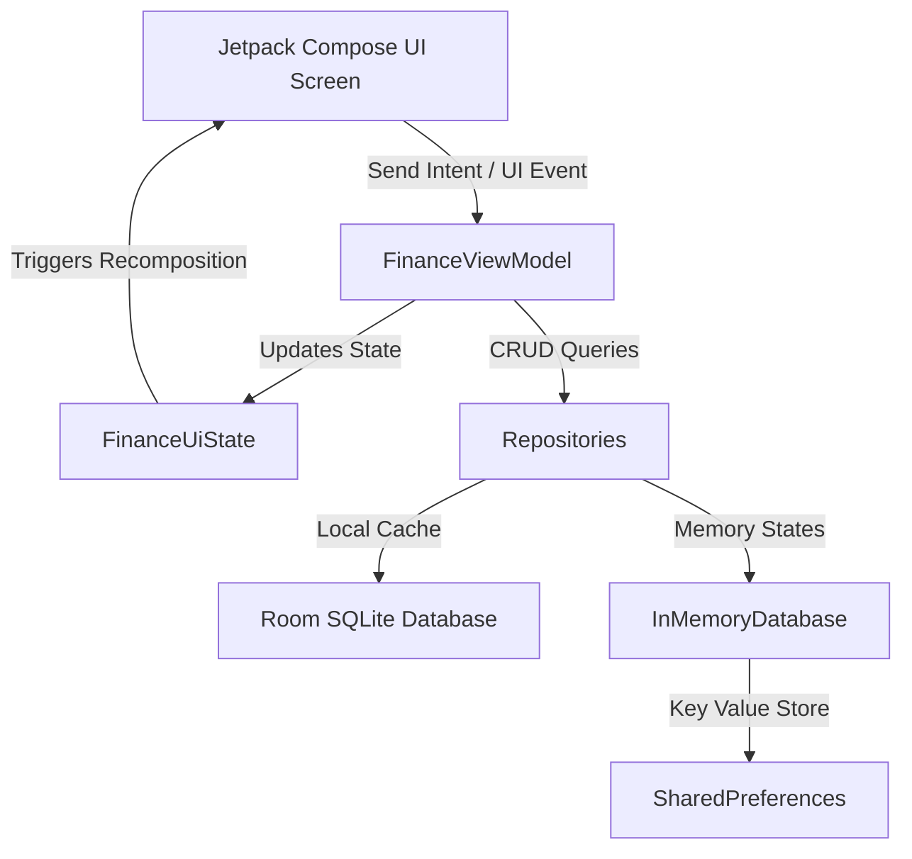

# VibeFinance 📊✨

VibeFinance is a modern, high-fidelity personal finance and daily budgeting Android application. Built using Jetpack Compose and Kotlin, it delivers a state-of-the-art visual experience with interactive animations, custom card layouts, and local data persistence. The design is highly inspired by the daily budgeting philosophy of **[Buckwheat](https://github.com/bndkt/buckwheat)** and the refined Material 3 UI/UX architecture of **[ImageToolbox](https://github.com/T8RIN/ImageToolbox)**.

---

## 🚀 Features

### Guided transaction selectors (1.2.31)
- **Expense / Income:** Category opens automatically, then choosing a category scrolls to and opens Asset Selection. **Transfer:** From Account opens first, then advances to Destination. The final choice closes the panel and leaves the keypad ready; saving still requires Apply.
- Every expanded panel uses **three columns**, including wide and larger-text layouts. Connected-button heights and keypad bounds are retained. Back/Collapse can stop the sequence, and the active or dismissed stage survives rotation.
- The first panel waits for the full-screen opening animation to finish. Each handoff closes the previous popup before native scrolling reveals the next selector, including short viewports.

### History selection motion (1.2.30)
- Selection controls expand/fade into an inset, raised toolbar above the record viewport. They occupy their own space and do not cover records with an overlay.
- Entering or leaving selection preserves the second bar’s scroll state and the analytics header layout. Checkboxes slide/fade into place, and selected records gently change color.
- Scrolled records fade at the edge below the toolbar; the leading edge stays clear at the top of the list. Reduced motion uses fades, Minimal switches immediately, and action buttons wrap as needed for larger text.

### Automatic period income estimate (1.2.29)
- Assets and Recurring learn an income estimate from recorded Income entries in up to three preceding periods matching Daily’s budget schedule. Recent periods have weights **3:2:1**; transfers, balance adjustments and the current unfinished period are excluded.
- Monthly schedules follow calendar-month boundaries; other schedules use the same number of local days. Zero-income periods count. The card shows how many periods were sampled, explains partial history, and distinguishes missing history from a recorded zero.
- The estimate updates with recorded history and budget-date changes. It is read-only and changes neither balances nor the budget; legacy manual values remain compatible with saved data and backups.

### Spent / Remaining card transitions (1.2.28)
- Tapping the budget card moves the exact amount and its label together with a short directional slide and fade. The indicator dots crossfade; the card bounds and budget calculations stay unchanged.
- Reduced motion uses a fade, and Minimal switches immediately. Rapid taps settle on the last selected view.

### Spending Trend mode transitions (1.2.27)
- Switching between **Cumulative** and **Daily** smoothly morphs the curve and fill while the scrub marker follows the same motion. Daily bars and the average guide fade in and out.
- Recorded amounts and chart bounds stay unchanged. Reduced motion uses a shorter transition; Minimal switches immediately. Existing connected-button corners and press behavior are retained.


### Automatic logging transitions and recovery (1.2.23)
- The allowed-app preview expands/collapses with Material height and fade motion when Automatic Transaction Logging changes. Reduced motion uses a fade; Minimal motion changes immediately.
- The Smart logging panel includes a recovery guide and an **Open notification access** button, available even when logging is off. It explains restarting VibeFinance and turning its Android notification access off and back on if capture stops.

### Settings haptic feedback (1.2.22)
- Settings section headers, option cards, action/dialog buttons, palette choices, category controls and completed slider gestures provide feedback through the existing haptic helper. Destructive actions use warning feedback.
- Switches retain their own feedback so a child switch tap does not also pulse its parent card. Cancelled presses and recomposition do not trigger feedback; Android's system haptic preference is respected.

### Investment organizers and theme-aware heatmaps (1.2.20)
- Add or edit an asset with the **Investment** type. Its recorded balance has a separate gold bar in Money Allocation, and is excluded from total assets and net value.
- Investment entries are only an app organization tool. They do not represent real-world investments, ownership, or returns. The reminder appears in the editor and distribution chart; entries and customization are included in full backups.
- The Habit & Contribution Grid uses the shared theme-aware progressive edge blur. Fades appear only on overflowing edges and respect the blur preference.

### Estimated income by budget period (1.2.19)
- Assets and Recurring show the same editable income estimate for the dates configured on Daily. Use the pencil to enter an amount in HKD; zero is valid and leaving the field blank clears it.
- This is a manual reference amount. It creates no transaction and changes neither balances nor spending allowances. Editing the budget amount keeps the estimate; changing its dates starts a new unset estimate. Estimates persist across relaunch and are included in full app backups; older saved data/backups remain compatible.

### Daily calendar and chart controls (1.2.18)
- Chinese habit heatmaps use compact weekday labels 一、二、三、四、五、六、日. Habit/Month and Spending Trend toggles keep their outer ends rounded while the inner-facing corners change shape on press.

### Adaptive page headers (1.2.15)
- The secondary title collapses without leaving its expanded space behind. It returns near the top of Daily, Assets, Recurring and History, using each page's actual scroll position. Header spacing follows the animated bar height, including system insets and larger text.

### One-tap transaction entry (updated in 1.2.17)
- Daily's extended Add FAB uses a rounded-square outline with 16dp corners and opens Expense directly. Switch Expense, Income or Transfer inside the full-screen form with the expressive connected control.
- Transaction entry uses the same right-side slide, fade and scale as Add/Edit Asset, covering the main toolbar, navigation and FAB. Back closes nested selectors and the keyboard before leaving the page.
- A dedicated top bar and large amount display sit above the scrolling form. The 4×4 calculator stays docked at the bottom in every mode, with 54dp keys and 24dp resting corners. Note hints match Expense, Income and Transfer. On short viewports or larger text, the amount can scroll with the form to keep fields reachable above the keypad.
- Scrolling down collapses the Daily FAB to its plus icon; scrolling back up expands the Add label again.
- Transaction buttons change shape on press without shrinking their contents or shifting neighboring buttons. Calculator corners morph from 24dp to 16dp with touch-down haptics, using the same 180ms press / 220ms return easing as the Assets connected buttons. Connected entry controls use 32dp outer/selected, 20dp inner and 14dp pressed corners. Category and account chips retain their animated selection widths and scroll fades.
- Entry connected groups have rounder corners without changing their height. Standard bottom sheets ease into and out of their 360ms opening/closing slide, respecting motion settings.
- Amount/calculations, note, source account and currency stay in one saveable draft through mode changes and rotation. Each mode shows its applicable budget/category/destination controls; Transfer requires a different destination account.
- Calendar Pay actions still open Transfer with the destination card prefilled and require confirmation.

### Financial tools (1.2.7)
- Credit cards show current-cycle spending, remaining cycle allowance, closing countdowns and payment urgency. Cycle allowance is separate from outstanding debt and excludes future transactions, transfers and balance adjustments; recorded credits reduce spending. Dates clamp to the last day of shorter months.
- History supports long-press/header selection, Select All within the filtered results, atomic Delete with Undo, category changes for the same transaction type, and account moves for Income/Expense records. Transfers and adjustments support deletion.
- The shared transaction keypad calculates additions and subtractions with decimal precision. Apply evaluates the expression before currency conversion; incomplete and nonpositive amounts cannot be submitted. Budget predictions retain the completed part of an expression while an operator is pending (for example, `6+` previews 6), including foreign-currency conversion.
- Daily calendar shows card-payment reminders even without a budget. Statement amounts are estimates from recorded entries in the relevant closed cycle. Pay opens Transfer with the card selected and requires confirmation.
- Recurring → Calendar options exports payment/subscription reminders as an ICS file. Card alarms are at 09:00 two days before and on the due date. Month-end subscriptions export the next 12 months using the existing schedule; re-export to refresh. Calendar copies do not update automatically.
- Day reminders can open the phone calendar editor without calendar permissions. Haptics respect system settings, nested sheets handle Back first, and existing motion preferences remain effective.


### 📅 Daily Budgeting & Heatmap
- **Budget setup**: When no budget exists, Daily → Set Budget opens the new-period form directly and returns to Daily after saving. Existing budgets open the budget editor.
- **Whole Budget Card**: Visualizes starting budgets with an elegant range indicator chip showing exact dates and days elapsed.
- **Spent & Remaining Wavy Bento Cell**: A fluid wave progress cell representing your remaining budget, dynamically adjusting wave frequency and amplitude. Tapping the cell toggles between "Remaining" and "Spent".
- **Days Left Bento Cell**: Displays a clean, concentric circular progress ring representing elapsed days of the active budget period.
- **Minimum & Maximum Spent Cards**: Showcases lowest and highest expenses with embedded Bezier spends curve animations and node markers.
- **Period Spends Heatmap Calendar**: Color-codes daily expenditures based on budget utilization, featuring radial glow backdrops ("spread") and overflow layout sizing for overspent days.

### 💳 Assets & Cards Manager
- **Full-screen Asset & Card editor**: Opens from the right with ImageToolbox-inspired slide, fade and scale motion; closing reverses the transition. Add and edit assets on one grouped, scrollable page. The preview stays composed while typing and moves to a separate pane in windows at least 720dp wide. Drafts survive rotation; closing changed drafts asks before discarding. Save waits for persistence and keeps the draft open if it fails.
- **Interactive Credit Utilization**: Live progress tracking of credit limits, outstanding balances, and available credit grids.
- **Transparent Default Style**: Renders cards with a clean, fully transparent glass-like backdrop by default, adapting text colors dynamically for optimal readability in both dark and light modes.
- **Custom Card Themes**: Enables customizing cards with vibrant gradients (e.g. Sunset Glow, Ocean Breeze, Emerald Forest) and background patterns (e.g. Cyber Grid).

### 💰 Persistent Cashback Rates
- **Account-level Custom Rates**: Allows setting custom cashback return rates (%) for specific categories (Food, Transport, Shopping, Utilities, Other) directly inside each account's edit dialog.
- **Automated Calculation & Triage**: Maps categories (such as "Food & Drink" or "Groceries") via keyword matching to calculate exact cashback amounts.
- **History Tracker**: Displays green indicators showing calculated cashback directly on individual transaction line items.
- **Summary Tracker**: Aggregates and displays total lifetime cashback earned under the asset card.
- **Persistent Storage**: Utilizes local `SharedPreferences` to persist configured rates across restarts and system upgrades.

### Privacy and History Search
- Optional local app lock uses Android biometrics or the device PIN/password. A secure device screen lock must be configured first. App-lock protection also hides screenshots and the Recents preview.
- The toolbar eye button and Settings → Data & privacy → Hide amounts mask displayed monetary values. These controls are optional and default off.
- Toggle the search icon beside Category Analytics to reveal a pill-shaped search bar below the page headings and above the budget-period card. It slides down to open and up to close; the filled icon indicates it is open. The bar’s filter button opens combined filters. History supports text search plus combined account, category, transaction type, inclusive date, and amount-range filters. CSV export follows the filtered records.
- Edit Income or Expense in History to switch its deposit/payment account or card above Category. Saving reverses the previous account effect and applies it to the chosen account; credit cards retain their debt semantics. Transfers keep separate source and destination selectors.
- Settings → Customization offers Full, Reduced, and Minimal motion and a blur-intensity slider. These are app settings and do not change device scaling or Android animation settings.
- Color scheme → Palette style selects Tonal spot, Vibrant, Expressive, Neutral, Monochrome or Fidelity. Select a variant and use the pencil to edit its seed color with hex/RGB controls and a live tonal preview. Scroll the variants to the + button to save a reusable Custom variant. Cancel discards edits; saved styles and colors survive restart and full-app backup/restore.
- New preferences are included in full-app backups. Successful app-lock authentication requires configured device credentials; passwords and unlocked sessions are never saved in backups.

### Payment notification actions
- Settings → Apps allowed to auto log opens immediately with the same Material loading indicator as App quick launch. App names load in the background, icons load for visible rows, and search/dismiss remain available during loading. Failed scans offer Retry.
- Auto-matched payment alerts are recorded immediately and show a native receipt for 30 seconds with **Undo** and **Change category** actions. Unmatched alerts retain the account-choice/create flow.
- Undo runs in the background and atomically removes the record and reverses its account effects, including credit-card debt and transfers. Repeated actions cannot refund twice; notification deduplication stays intact.
- Change category opens the app directly to a focused picker for that receipt. Saving changes only its category; deleted receipts show an unavailable message.
- Android 16 promotion is requested with AndroidX Core compatibility support and the manifest permission. Status-bar chips/lock-screen capsules/Now Bar are controlled by the OS, device maker and user settings. Google’s [Live Update guidance](https://developer.android.com/develop/ui/compose/notifications/live-update) excludes completed alerts, so these receipts may remain standard heads-up notifications. Android 8+ uses a native 30-second timeout; Android 7 has a process-local fallback. Notification permission and channel settings still apply.

### ⚡ Smooth Transitions
- Settings uses compact [ImageToolbox-inspired](https://github.com/T8RIN/ImageToolbox) cards: 10dp side margins, 6dp gaps, 72dp minimum headers and 40dp icon badges. Groups initially appear collapsed beneath a simple pinned toolbar; expanded controls retain rounded press feedback and scroll blur. Colors follow the selected light/dark theme.
- The Settings drawer has 28dp rounding on its free left edge and square corners flush against the right bezel, with its toolbar surface continuing behind the status bar. Native Material drawer insets keep controls clear of status icons and display cutouts. It prefers a 280–360dp width and reserves at least 56dp of touchable scrim; windows narrower than 336dp use a smaller drawer to preserve that margin.
- Settings opens from the right beside the toolbar Settings icon in a Material 3 navigation drawer with a 320 ms emphasized-decelerate slide (`0.05, 0.7, 0.1, 1`). Swipe right, tap outside, use Back, or press Close to dismiss it. Existing settings cards and scroll blur stay available; focused budget configuration and nested pickers retain their modal windows. Page and settings content keep their normal reading direction.
- Native bottom-sheet slides and scrims use a shared 320 ms ease-in/ease-out curve. Reduced/Minimal motion and Android animation preferences still apply, and animations inside each sheet keep their existing behavior.
- Replaced bouncy spring animations with high-performance ease-in-out page transitions (`tween(350)`), making tab switching feel stable, fluid, and robust.

---

## 🎨 Design & Inspiration

VibeFinance's interface and user experience are deeply influenced by two standout open-source projects:

- **[Buckwheat](https://github.com/bndkt/buckwheat)**: The core personal budgeting philosophy—tracking daily spending limits, the dynamic period spend heatmap calendar, days-left indicators, and fluid bento-grid budget metrics—is heavily inspired by Buckwheat's thoughtful, stress-free approach to daily finances.
- **[ImageToolbox](https://github.com/T8RIN/ImageToolbox)**: The expressive Material 3 styling—including compact grouped settings cards with 10dp margins and 6dp gaps, right-docked navigation drawer, dynamic tonal color scheme palettes, and tactile rounded ripple animations—draws direct inspiration from ImageToolbox's modern Android design patterns.

---

## 🏗️ Architecture

The app is built on a clean **Model-View-ViewModel (MVVM)** architecture with Unidirectional Data Flow (UDF):



### Key Components:
- **`MainActivity.kt`**: App entry point, responsible for requesting runtime notifications and initializing the database connection.
- **`FinanceViewModel.kt`**: Coordinates state across all navigation tabs, executing operations via repository modules.
- **`InMemoryDatabase.kt`**: Handles state caching, category spending limits, and persistent cashback rule tables.
- **`AccountsScreen.kt`**: Layout rules and interactive card canvas drawings for the Assets & Cards section.
- **`HomeScreen.kt`**: Manages the main daily budget dashboard and calendar heatmap grid views.
- **`HistoryScreen.kt`**: Displays transactional breakdowns and dynamic cashback labels.

---

## 🛠️ Tech Stack

- **UI Framework**: [Jetpack Compose](https://developer.android.com/compose) (Declarative Kotlin UI)
- **Database**: [Room](https://developer.android.com/training/data-storage/room) (SQLite ORM)
- **Background Jobs**: [WorkManager](https://developer.android.com/topic/libraries/architecture/workmanager) (Daily credit card deadline checks)
- **Local Settings**: [SharedPreferences](https://developer.android.com/reference/android/content/SharedPreferences) (Cashback rules and rates)
- **Architecture**: Kotlin Coroutines, Kotlin Flows, Android Arch Components

---

## 📥 Getting Started

### 📋 Prerequisites
- Android Studio Ladybug (or newer)
- Android SDK 34+
- Java JDK 17

### 🛠️ Build & Installation
Build the debug APK using the Gradle wrapper:
```bash
./gradlew assembleDebug
```

Install it on a connected emulator or physical device:
```bash
adb install -r app/build/outputs/apk/debug/app-debug.apk
```

### 🧪 Run Unit Tests
```bash
./gradlew testDebugUnitTest
```

---

## 🔍 Knowledge Graph (`graphify`)

We use **Graphify** to maintain a persistent knowledge graph of the codebase for navigation and dependency tracking.

### Update the Graph
If you modify code files, keep the graph current with AST-only extraction (free, no API cost):
```bash
graphify update .
```

### Outputs
All outputs are located under `graphify-out/`:
- `graph.html`: Interactive graph visualization.
- `GRAPH_REPORT.md`: Audit report highlighting God Nodes and Surprising Connections.
- `graph.json`: Raw node and edge data.
