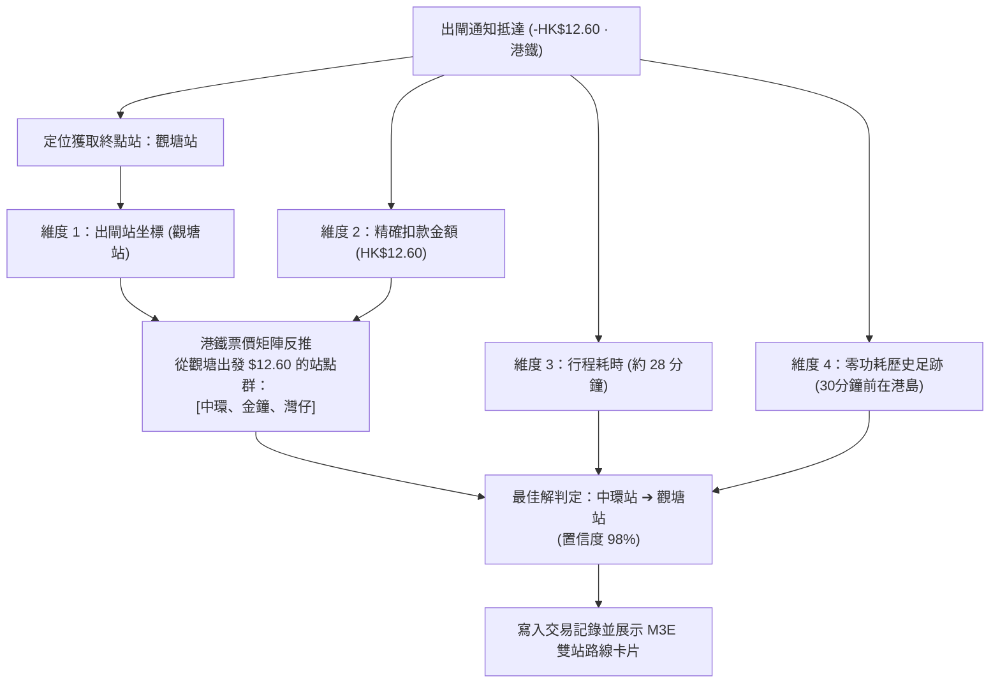

# 港鐵全自動起點與終點追蹤研發記錄 (Experimental: Hands-Free MTR Transit OD Engine)

> **文檔狀態**：研發與實驗規範 (R&D Specification)  
> **更新時間**：2026-11-04  
> **適用平台**：Android (Jetpack Compose / VibeFinance) · Smart Octopus (eSE) / 實體八達通  

---

## 1. 核心願景與問題背景

在日常通勤與個人財務記賬中，傳統自動記賬僅能捕捉到：
- **傳統記錄**：`-HK$12.60 · 港鐵`（資訊單一，無法反映乘車軌跡與通勤模式）。
- **目標體驗**：**`中環 ➔ 觀塘 · -HK$12.60`**，並在地圖上繪製「起點 ➔ 終點」的雙站路線，且**全程 100% 免手動（Zero-Touch / Hands-Free）**，無需用戶在入閘時掏出手機解鎖或手動操作。

### 關鍵技術挑戰：入閘時的「零通知」現象
1. **入閘機扣款為 $0.00**：
   - 港鐵閘機在乘客入閘時僅檢查卡片有效性並寫入入閘時間與車站編碼，**不產生任何扣款（HK$0.00）**。
   - Android 系統、Samsung Wallet、Google Pay 及各銀行 App 僅在**產生大於 $0 的金額扣款時**發送推播通知。
2. **出閘時一次性結算**：
   - 只有在出閘拍卡時，閘機才計算總票價（如 $12.60）並觸發扣款推播。
   - 這意味著系統的 `PaymentNotificationListener` **只會在乘客抵達「終點站」並出閘的那一刻被喚醒**。

---

## 2. 硬體邊界分析：為什麼無法直接攔截晶片寫入？

我們對 Android 系統底層及 Samsung Galaxy (e3q / S24 Ultra) 的硬體架構進行了深入診斷，得出以下安全限制：

```
[港鐵閘機 13.56MHz RF]
          │ (SWP 物理直通，歷時 < 200ms)
          ▼
   [手機 NFC 天線] ───► [獨立安全元件 eSE1 (Smart Octopus 晶片)]
                                   │ (ARA-M 權限鎖定)
                       [Android 核心 / CPU / 第三方 App] (完全隔離，不參與數據傳輸)
```

1. **硬體物理直通 (Off-Host Secure Element)**：
   - Smart Octopus 是運行在專用安全晶片（`eSE1`）上的 Applet。通訊經由 Single Wire Protocol (SWP) 在天線與安全晶片間直接完成，**數據不經過 Android Linux 核心或 CPU 記憶體**。甚至在手機關機或沒電時，入閘拍卡依然能正常運行。
2. **GlobalPlatform ARA-M 權限鎖**：
   - Android 系統的 `android.nfc.action.TRANSACTION_DETECTED` 廣播受到 `mSEService.isNFCEventAllowed()` 門禁管制。
   - eSE1 晶片出廠時設定了存取白名單，只有經八達通公司與三星官方簽名的特定簽名雜湊（`com.samsung.android.spay` 和 `com.octopuscards.nfc_reader`）才能監聽，任何未授權的第三方 App 均無法接收。

---

## 3. 出閘反推四重鎖定架構 (Quad-Lock Reverse Deduction Engine)

由於入閘無法也不應被暴力破解，我們設計了**出閘逆向多維鎖定算法（Quad-Lock Engine）**。

### 「車站訊號好」是否會影響反推？
**不會，反而大幅提升精準度！**
- **情境 A（全露天/架空車站，如東鐵綫、屯馬綫、觀塘綫高架段）**：
  - GPS 信號與移動網絡在行車過程中從未中斷。
  - 系統被動足跡緩存直接完整記錄：`18:00 沙田站 (靜止) ➔ 18:05~18:24 高速鐵路運動 (60~80 km/h) ➔ 18:25 抵達觀塘站 ➔ 18:28 出閘`。
  - **結論**：起點直接為沙田站，準確率為 **100% 絕對確定**。
- **情境 B（深層地底車站，如中環、金鐘、何文田）**：
  - 依靠四重防護網交叉鎖定：



#### 四個鎖定維度詳解：
1. **維度 1（終點站 Destination Station）**：
   - 收到通知時喚醒 GNSS/Fused Location，並與內建 99+ 港鐵車站經緯度進行距離計算（< 300 米），精確識別出閘站。
2. **維度 2（扣款金額 Exact Fare）**：
   - 官方票價是嚴格確定性的。例如在成人票價下，從觀塘站出閘收費 $12.60 的區間僅限於特定的跨海過海站點。
3. **維度 3（乘車耗時 Travel Duration）**：
   - $\Delta t = T_{出閘} - T_{足跡離站}$。港鐵運行時間極為標準（例如中環至觀塘約 28 分鐘），可有效排除耗時過短（如 10 分鐘九龍區站點）或過長（如 50 分鐘新界站點）的同票價候選站。
4. **維度 4（零功耗足跡 Passive Breadcrumbs）**：
   - 利用 Android `LocationManager.PASSIVE_PROVIDER`（借用其他 App 定位，**0% 額外耗電**）。
   - 保留最近 1~2 小時內的粗略軌跡點，辨別乘客是從「港島區」、「九龍西」還是「新界東」出發。

---

## 4. 乘客身份分類與票價結構 (Adult, Student, Child, JoyYou)

港鐵對不同年齡與身份的乘客設有不同的票價體系：

| 身份類別 | 八達通卡種 | 票價特徵 | 優惠範圍與例外 |
| :--- | :--- | :--- | :--- |
| **成人 (Adult)** | 成人八達通 / Smart Octopus | 全額標準票價 (`OCT_ADT_FARE`) | 基準票價，無額外折扣 |
| **學生 (Student)** | 學生個人八達通 (12-25歲) | 約 **50% 折扣** (`OCT_STD_FARE`) | 僅限港鐵重鐵網絡；機場快綫、東鐵綫頭等及羅湖/落馬洲過境無學生優惠 |
| **小童 (Child)** | 小童八達通 (3-11歲) | 約 **50% 折扣** (`OCT_CHD_FARE`) | 全綫網絡（含輕鐵及港鐵巴士）特惠收費 |
| **樂悠咭 / 長者 (JoyYou / Senior)** | 樂悠咭 (60歲或以上) / 長者八達通 | **HK$2.00 劃一優惠** (`OCT_SNR_FARE`) | 政府公共交通票價優惠計劃；原票價不足 $2 則按原特惠價扣除 |

### VibeFinance 的多身份反推處理策略
1. **帳戶身份設定（靜態綁定）**：
   - 在 VibeFinance 的「帳戶設定」中，用戶可為 Smart Octopus 或交通卡綁定身份屬性（`Adult` / `Student` / `Child` / `JoyYou`）。
   - 系統依據綁定身份直接載入對應的票價矩陣欄位進行反推。
2. **動態智能識別（自適應推斷）**：
   - 若用戶未明確設定身份：
     - 若扣款金額為 **固定 HK$2.00** ➔ 自動判定為樂悠咭/長者優惠，並切換至時空足跡與線路耗時為主的推斷模式。
     - 若扣款金額吻合學生/小童半價特徵 ➔ 比對特惠矩陣反推起點。
     - 若扣款金額吻合常規票價 ➔ 比對成人矩陣反推起點。

---

## 5. 港鐵票價動態更新機制 (Dynamic Open Data Fare Sync)

港鐵每逢春夏季（通常在 6～7 月）會根據「可加可減機制（Fare Adjustment Mechanism, FAM）」調整全網票價。為確保反推引擎永不過期，架構採用**離線優先 + 雲端開放數據定期同步**雙層設計：

### 官方數據來源
香港政府地理與公共交通開放數據平台（**DATA.GOV.HK**）：
- **資料集名稱**：*MTR routes, fares and barrier-free facilities*（港鐵路線、收費及無障礙設施）
- **發布機構**：MTR Corporation Limited / 運輸署 (Transport Department)
- **核心數據欄位**：
  - `SRC_STATION_NAME`：起點站名（中英文）
  - `DEST_STATION_NAME`：終點站名（中英文）
  - `OCT_ADT_FARE`：八達通成人票價
  - `OCT_STD_FARE`：八達通學生票價
  - `OCT_CHD_FARE`：八達通特惠/小童票價
  - `OCT_SNR_FARE`：長者票價

### 更新同步架構
```
[DATA.GOV.HK 官方開放數據 CSV]
          │ (每月檢查 / 檢測到新票價時按需拉取)
          ▼
[VibeFinance FareSyncManager (背景 WorkManager)]
          │ (解析成輕量 SQLite / Binary 緊湊查詢表)
          ▼
[本地快取：mtr_fares_vX.db] ◄── [備援內建資產：assets/mtr_fare_matrix.json]
```

1. **內建基礎庫 (`assets/mtr_fare_matrix.json`)**：
   - APK 隨附最新基準矩陣，初次安裝即可 100% 離線使用，0 毫秒延遲，不依賴網路。
2. **自動靜態增量同步**：
   - 每月透過 WorkManager 在 Wi-Fi 且充電狀態下檢查開放數據 ETag，若港鐵公布新票價則自動更新本地快取。
3. **未知票價容錯學習**：
   - 若攔截到的金額不在本地矩陣中（例如特設推廣折扣），自動標記待聯網更新，並依據前後站足跡做彈性逼近。

---

## 6. UI/UX 呈現規範 (Material 3 Expressive)

在 `TransactionDetailDialog.kt` 與歷史列表中，港鐵出行的呈現規格如下：

### 1. 交易清單列表行 (Transaction Item)
- **主標題**：`中環 ➔ 觀塘`
- **副標題**：`18:28 · Smart Octopus · 歷時約 28 分鐘`
- **金額**：`-HK$12.60`
- **圖示**：港鐵路綫專屬列車圖示 (`Icons.Outlined.DirectionsSubway`)

### 2. 詳情彈窗行程卡片 (Transit Route Bento Card)
```
┌───────────────────────────────────────────────┐
│ 🚇 港鐵行程 (MTR Transit)           28 分鐘   │
│                                               │
│  🟢 18:00  中環站 (Central)                   │
│    │  港島綫 / 觀塘綫                         │
│  🔴 18:28  觀塘站 (Kwun Tong)                 │
│                                               │
│  💳 Smart Octopus · 成人收費 -HK$12.60        │
│  [🔄 切換起點站為：金鐘]                      │
└───────────────────────────────────────────────┘
```
- **容錯一鍵校正**：當置信度在相鄰站點（如中環與金鐘）存在微小重疊時，卡片提供輕觸快速切換按鈕，點擊 1 秒內即可無縫調整並儲存。

### 3. OpenStreetMap 地圖動態繪製
- 繪製 **綠色起點圖釘 (Start Pin)** 與 **紅色終點圖釘 (End Pin)**。
- 在兩站之間渲染一條帶有平滑微彎曲的彩色路徑（Polyline），直觀還原過海與市區通勤全貌。

---

## 7. 研發推進檢查清單 (Roadmap Checklist)

- [ ] **Phase 1: 港鐵站點知識庫 (`MtrStationRegistry.kt`)**
  - 收錄全港 99+ 重鐵車站的經緯度與車站中文/英文名稱。
  - 封裝 `findNearestStation(lat, lon, maxDistanceMeters = 500)` 方法。
- [ ] **Phase 2: 票價矩陣與乘客身份解析 (`MtrFareEngine.kt`)**
  - 整合 `DATA.GOV.HK` 的最新票價表，支援 Adult、Student、Child 及 JoyYou 查詢。
  - 實現 `deduceStartingStations(destStation, fareAmount, passengerType)` 逆向求解器。
- [ ] **Phase 3: 零功耗足跡歷史隊列 (`GnssLocationManager.kt`)**
  - 建立容量為 50 的時間戳記滑動隊列 `recentLocationBreadcrumbs`。
  - 使用 `PASSIVE_PROVIDER` 收集背景非主動位置，維持 0% 額外耗電。
- [ ] **Phase 4: 通知監聽攔截聯動 (`PaymentNotificationListener.kt`)**
  - 當商戶名稱為「港鐵」且扣款大於 0 時，觸發 Quad-Lock 反推引擎。
  - 自動寫入 `startLocationName`、`startLatitude`、`startLongitude` 及路線名稱。
- [ ] **Phase 5: M3E 行程卡片與雙點地圖繪製 (`TransactionDetailDialog.kt`)**
  - 實作起訖雙點路線卡片與 OpenStreetMap 軌跡可視化。
